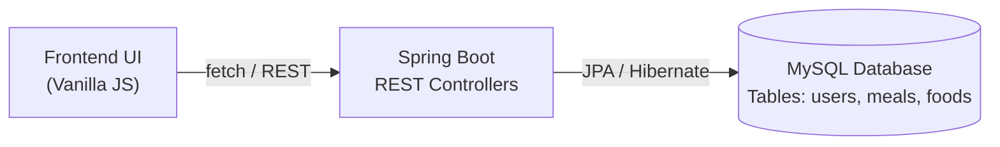

# NutriTrack – Diet Balancing Web Platform

A professional, fully responsive, independent frontend Diet Balancing Web Platform built with **HTML5**, **CSS3**, and **Vanilla JavaScript**, featuring **Chart.js** and **Bootstrap Icons**.

> **Academic Project Note:** This application is built as a complete client-side MVP. It runs **100% independently in the browser** without requiring a live MySQL server, Node.js backend, Spring Boot runtime, or external API keys. Data persistence is managed via `localStorage`, and the JavaScript service layer is structured to map directly to future Spring Boot REST controllers and MySQL database tables.

---

## 1. Key Features & Pages

| Page | File | Description |
| :--- | :--- | :--- |
| **Landing Page** | `index.html` | High-impact hero section ("Eat Smart. Live Healthy."), feature showcases, 3-step workflow, benefits, and call-to-action buttons. |
| **Registration Page** | `register.html` | User onboarding form with physical metrics (age, gender, height, weight, activity level, fitness goal) and client-side validation. |
| **Login Page** | `login.html` | Session authentication with Remember Me, credential checks, and a 1-click **Quick Demo Login** for rapid evaluation. |
| **Main Dashboard** | `dashboard.html` | Dynamic calorie circular progress meter, macronutrient progress bars (Protein, Carbs, Fat), Chart.js graphs, today's meal log, and rule-based insights. |
| **Food Database** | `food.html` | Searchable catalog of 32+ realistic food items across 7 categories with real-time search, category filtering, calorie sorting, detail modals, and quick meal logging. |
| **Add Meal Page** | `add-meal.html` | Meal logging with live dynamic calculation of calories and macros as grams are typed, quantity shortcuts, and date-filtered log table with inline edit and delete. |
| **Meal History** | `history.html` | Chronological date-wise meal breakdown, 7-day interactive weekly Chart.js bar chart with daily target line, metric summary cards, and full CRUD controls. |
| **Recommendations** | `recommendations.html` | Rule-based nutritional engine evaluating protein gaps, fiber/vegetable intake, caloric deficit/surplus, foods to include vs moderate, and tailored meal schedules. |
| **User Profile** | `profile.html` | Profile management displaying interactive BMI visual gauge, Mifflin-St Jeor BMR calculation breakdown, macro target ratios, and editable physical metrics. |

---

## 2. Scientific Calculation Engine

### A. Body Mass Index (BMI)
$$\text{BMI} = \frac{\text{Weight (kg)}}{(\text{Height (m)})^2}$$

- **Below 18.5:** Underweight
- **18.5 – 24.9:** Normal range (Healthy)
- **25.0 – 29.9:** Overweight
- **30.0 and above:** Obesity range

### B. Basal Metabolic Rate (BMR) – Mifflin-St Jeor Equation
- **Male:**
  $$\text{BMR} = 10 \times \text{weight (kg)} + 6.25 \times \text{height (cm)} - 5 \times \text{age (y)} + 5$$
- **Female:**
  $$\text{BMR} = 10 \times \text{weight (kg)} + 6.25 \times \text{height (cm)} - 5 \times \text{age (y)} - 161$$

### C. Estimated Maintenance & Daily Caloric Targets
$$\text{Maintenance Calories} = \text{BMR} \times \text{Activity Multiplier}$$

- **Sedentary:** 1.2
- **Lightly Active:** 1.375
- **Moderately Active:** 1.55
- **Very Active:** 1.725

**Fitness Goal Adjustments:**
- **Weight Loss:** $\text{Maintenance} - 300\text{ kcal}$
- **Weight Maintenance:** $\text{Maintenance}$
- **Weight Gain:** $\text{Maintenance} + 300\text{ kcal}$

### D. Dynamic Meal Nutrient Calculation Formula
$$\text{Nutrient Amount} = \frac{\text{Nutrient per 100g} \times \text{Quantity in grams}}{100}$$

---

## 3. Technology Stack & Design System

- **Frontend Core:** HTML5 Semantic Markup, CSS3 Flexbox & CSS Grid, Vanilla JavaScript (ES6+).
- **Typography:** Google Fonts (`Inter` for body & `Poppins` for headings).
- **Color Palette:**
  - Primary Fresh Green: `#2EAD70`
  - Secondary Dark Green: `#176B4D`
  - Background Neutral: `#F7F9F7`
  - Card Background: `#FFFFFF`
- **Charts:** Chart.js 4.4.2 (Macronutrient Doughnut & 7-Day Trend Bar Chart).
- **Icons:** Bootstrap Icons 1.11.3 CDN.
- **Persistence:** Browser `localStorage` (Isolated user profiles, meal logs, session keys).

---

## 4. Project Directory Structure

```
NutriTrack/
│
├── index.html              # Landing Page
├── login.html              # User Authentication Page
├── register.html           # User Registration & Physical Profiling
├── dashboard.html          # Main Nutrition Dashboard
├── food.html               # Searchable Food Catalog (30+ items)
├── add-meal.html           # Meal Logger with Live Nutrient Calculator
├── history.html            # Meal History & 7-Day Chart Analytics
├── recommendations.html    # Rule-Based Recommendation Engine
├── profile.html            # User Profile, BMI Gauge & Target Editor
├── README.md               # Documentation & Academic Architecture
│
├── css/
│   ├── style.css           # Global Design System, Typography & Layout
│   ├── auth.css            # Split-Screen Auth & Showcase Styles
│   ├── dashboard.css       # Widgets, Progress Bars, Charts & Cards
│   └── responsive.css      # Breakpoints for Desktop, Tablet & Mobile
│
├── js/
│   ├── food-data.js        # Standardized Food Dataset (per 100g)
│   ├── storage.js          # LocalStorage CRUD & Scientific Formulas
│   ├── auth.js             # Session Handling & Route Protection
│   ├── app.js              # Header Sync, Sidebar Drawer & Global Toasts
│   ├── dashboard.js        # Dashboard Calculations, Meters & Chart.js
│   ├── food.js             # Food Filtering, Sorting & Modal Logging
│   ├── meals.js            # Live Dynamic Calculation & Daily Log Table
│   ├── history.js          # Multi-Day Filtering & 7-Day Trend Chart
│   ├── recommendations.js  # Nutrition Gap Engine & Meal Planner
│   └── profile.js          # BMI Gauge, Mifflin-St Jeor & Form Editor
│
└── assets/
    ├── icons/
    │   ├── logo.svg        # Scalable Vector Brand Logo
    │   └── favicon.svg     # Browser Favicon
    └── images/             # Static Assets Directory
```

---

## 5. Quick Start & Evaluation Guide

1. **Open the Project:**
   - Double-click `index.html` or open any `.html` file directly in any modern web browser (Google Chrome, Firefox, Safari, Microsoft Edge).
   - Alternatively, serve with any local static web server:
     ```bash
     # Optional: Python static server
     python -m http.server 8000
     ```

2. **Instant Demo Login:**
   - On `login.html`, click the **"Demo Login"** button in the top banner.
   - Or use the pre-seeded credentials:
     - **Email:** `demo@nutritrack.com`
     - **Password:** `password123`
   - The demo account is pre-populated with **7 days of realistic meal logs**, rendering live charts, circular progress indicators, and recommendations instantly.

3. **Register a Fresh User:**
   - Click "Register" to create a new profile with custom age, height, weight, activity level, and goal.
   - Notice how all target calculations (BMR, BMI, Calorie Target, Macro distribution) adjust automatically.

---

## 6. Future Backend Integration Roadmap (Spring Boot + MySQL)

The client-side architecture in `js/storage.js` is structured to seamlessly migrate to REST API calls:



### Relational Database Schema Planned:
```sql
CREATE TABLE users (
    user_id VARCHAR(50) PRIMARY KEY,
    full_name VARCHAR(100) NOT NULL,
    email VARCHAR(100) UNIQUE NOT NULL,
    password_hash VARCHAR(255) NOT NULL,
    age INT NOT NULL,
    gender ENUM('Male', 'Female') NOT NULL,
    height_cm DECIMAL(5,2) NOT NULL,
    weight_kg DECIMAL(5,2) NOT NULL,
    activity_level VARCHAR(30) NOT NULL,
    fitness_goal VARCHAR(30) NOT NULL,
    created_at TIMESTAMP DEFAULT CURRENT_TIMESTAMP
);

CREATE TABLE foods (
    food_id VARCHAR(50) PRIMARY KEY,
    food_name VARCHAR(100) NOT NULL,
    category VARCHAR(50) NOT NULL,
    calories_per_100g INT NOT NULL,
    protein_per_100g DECIMAL(5,2) NOT NULL,
    carbs_per_100g DECIMAL(5,2) NOT NULL,
    fat_per_100g DECIMAL(5,2) NOT NULL,
    fiber_per_100g DECIMAL(5,2) NOT NULL
);

CREATE TABLE meals (
    meal_id VARCHAR(50) PRIMARY KEY,
    user_id VARCHAR(50) NOT NULL,
    food_id VARCHAR(50) NOT NULL,
    food_name VARCHAR(100) NOT NULL,
    category VARCHAR(50) NOT NULL,
    meal_type ENUM('Breakfast', 'Lunch', 'Dinner', 'Snacks') NOT NULL,
    quantity_grams DECIMAL(6,2) NOT NULL,
    calories INT NOT NULL,
    protein DECIMAL(5,2) NOT NULL,
    carbohydrates DECIMAL(5,2) NOT NULL,
    fat DECIMAL(5,2) NOT NULL,
    fiber DECIMAL(5,2) NOT NULL,
    meal_date DATE NOT NULL,
    meal_time TIME NOT NULL,
    created_at TIMESTAMP DEFAULT CURRENT_TIMESTAMP,
    FOREIGN KEY (user_id) REFERENCES users(user_id) ON DELETE CASCADE
);
```

---

## 7. Academic Verification & Testing Checklist

- [x] **No MySQL server required** for evaluation.
- [x] **No Node.js / npm dependencies** or build steps required.
- [x] **No API keys or external authentication services** required.
- [x] **User Registration & Login** simulated with `localStorage`.
- [x] **Session Handling & Route Protection** active across all private pages.
- [x] **Mifflin-St Jeor Equation** dynamically calculates BMR & daily caloric maintenance.
- [x] **BMI Formula & Visual Gauge** with 4 distinct category ranges.
- [x] **Dynamic Meal Formula** accurately scales nutrients by grams consumed.
- [x] **Circular SVG Progress Meter & Macro Progress Bars** update live.
- [x] **Searchable Food Catalog** with 32+ realistic foods and category filtering.
- [x] **Interactive Charts** (Macronutrient distribution & 7-day weekly history trend).
- [x] **Rule-Based Recommendation Engine** evaluates caloric deficit/surplus, protein gaps, and vegetable intake.
- [x] **Responsive Layout** supporting Desktop (sidebar), Tablet, and Mobile devices.

